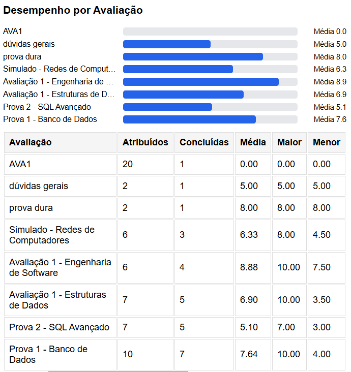
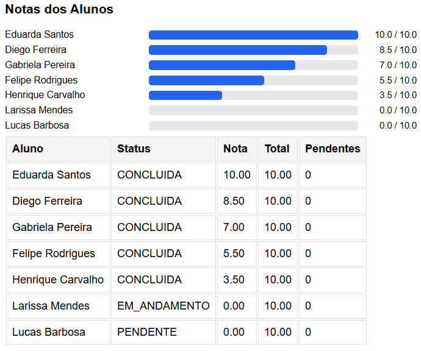
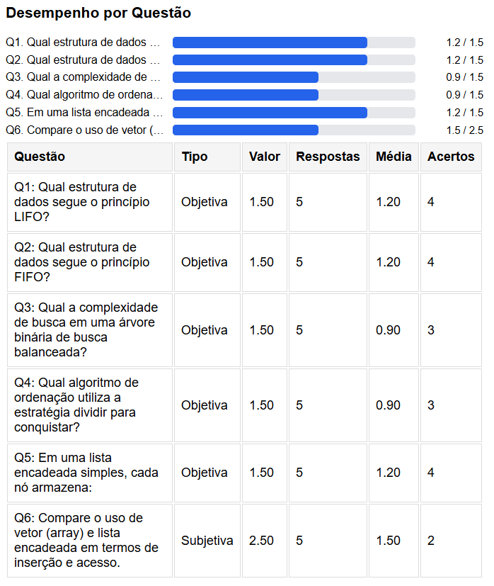

# Prova 2 - Banco de Dados 1
***
## Integrantes:
### - Aluisio de Oliveira Barbosa (Ciência da Computação);
### - Renan José Silva Santos (Ciência da Computação).
###

***

## Natureza do sistema:
### - Avaliação de aprendizagem (provas, simulados, quizzes).
### - Particularidade: Cada questão vinculada a uma avaliação possui um valor específico. Ao finalizar a prova, o sistema corrige automaticamente as questões objetivas (ou de múltipla escolha) comparando a alternativa marcada com o gabarito, enquanto as questões subjetivas ficam disponíveis para o professor atribuir ou atualizar a nota manualmente. A nota final de cada aluno é calculada dinamicamente pela soma das notas obtidas em cada questão.

***

## Tecnologias utilizadas:
### - SGBD: PostgreSQL;
### - Frontend: React + Vite;
### - Backend: Java com Spring Boot e acesso via JDBC.

***

## Como rodar o sistema:
### 1) PostgreSQL:
#### - Crie um banco de dados vazio no PostgreSQL chamado prova2;
#### - Execute o script database/schema.sql para criar todas as tabelas e restrições de integridade;
#### - Em seguida, execute o script database/carga.sql para inserir os dados iniciais de teste.

### 2) Backend (pelo Intellij IDEA):
#### - Acesse a pasta do back-end e confira as credenciais do banco (url, username e password) no arquivo src/main/resources/application.properties (porta padrão 5432, banco prova2);
#### - No arquivo src/main/java/DemoApplication, execute pelo botão de play no canto superior da tela;
#### - A API ficará disponível em http://localhost:8080/api.

### 3) Frontend (React + Vite):
#### - Acesse a pasta do front-end e instale as dependências com npm install;
#### - Inicie o servidor de desenvolvimento com npm run dev;
#### - Abra o navegador no endereço exibido no terminal (por padrão, http://localhost:5173).

### 4) Usuários de teste:
#### - Professor: carlos.silva@uel.br | Senha: 123456;
#### - Aluno: renan@uel.br | Senha: 123456.

***

## Relatórios:
### - Desempenho Geral por Avaliação:
#### - Apresenta um comparativo entre todas as avaliações cadastradas, exibindo o total de alunos atribuídos, quantos concluíram a prova, a média geral, a maior nota e a menor nota da turma.

### - Notas e Participação dos Alunos por Avaliação:
#### - Lista todos os alunos vinculados a uma avaliação selecionada (incluindo quem ainda não respondeu ou está com a prova em andamento), sua nota obtida, o valor total da prova e a quantidade de questões dissertativas aguardando correção.

### - Desempenho por Questão:
#### - Avalia o aproveitamento médio e o número de acertos completos em cada questão de uma avaliação selecionada, permitindo identificar os tópicos com maior índice de dificuldade.

